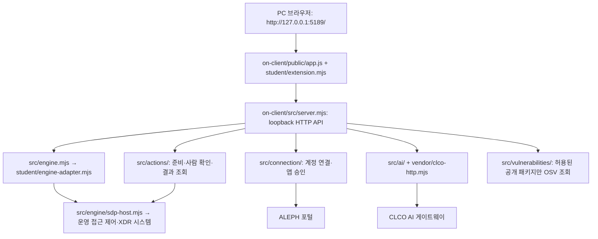

# 헤임달 학생용 실행 설명서 · 21단계

작성·확인일: 2026-10-27 (한국시간). 이 문서는 현재 저장소의 실행 파일과
학생 구현을 대조한 안내다. 제공 문서는 수정하지 않았다.

## 목적과 지원 범위

13~20단계에서 만든 보안 Agent는 본인 신원·기기·세션, 업무 앱 접속 판정,
보안 기록, AI 연결·사건 설명·조치 상태, 설치 패키지 조회 결과를 표시한다.
화면 제목의 기본 이름은 `케셰브`다. 포털에서 정한 `헤임달`이 이미 받은
앱 제목까지 자동으로 바꾸지는 않는다.

로컬 앱 실행, 실제 SDP/XDR 연결, AI 앱 승인, AI 설명, 보안 조치의 효과,
ALEPH 단계 판정은 각각 별도 결과다. `demo`, `disconnected`, `unknown`,
조회 실패를 실제 연결 또는 성공으로 기록하지 않는다.

| 환경 | 코드·설정 기준 | 이번에 직접 확인한 값·범위 |
|---|---|---|
| Windows / PowerShell | 제공 실행 도구는 Windows용 | PowerShell 7.6.5, Windows PowerShell 5.1.26100.9711 버전 출력 |
| Node.js | 실행 도구는 22~24 허용, `on-client/package.json`의 engines는 24.19.0 | v24.21.0에서 문법 검사 통과·서버 시작 메시지 확인. 기준 버전과 다름 |
| npm | `npm.cmd`로 PowerShell 실행 정책에 의한 npm.ps1 문제 회피 | 11.19.0 |
| Git | 커밋·원문 묶음 생성에 필요 | 2.55.0.windows.5 |
| 제공 앱 | `on-client/package.json` | 0.2.14 |
| 브라우저 | PC 브라우저에서 loopback 주소 사용 | 이번 5189 접속은 시간 초과. 렌더링·버튼 조작은 미확인 |
| 다른 환경 | macOS/Linux, 모바일, 원격 공개 호스팅 | 이번 설명서의 실행 검증 범위 밖 |

로컬 앱은 외부 npm 의존성이 없고 빌드 없이 실행한다. `on-client`에는
package-lock.json이 없다. 루트 package.json/package-lock.json은 별도
1~12단계 메모 앱용이며, 루트의 `npm run build`를 Agent 실행에 쓰지 않는다.
처음 Node.js를 설치한다면 공식 https://nodejs.org 의 수업 기준 안내를 따른다.
Workbench 상시 실행은 로컬 서버의 실행 조건이 아니다.

## 폴더와 담당 경계

Git 최상위 폴더는 `Aleph_Defense`이고 앱 폴더는 그 아래 `on-client`다.

```text
Aleph_Defense/
  README.md                         전체 프로젝트 기록과 이 설명서 링크
  docs/STUDENT_RUNBOOK.md            이번 학생 실행 설명서
  on-client/
    package.json                    제공 실행·문법 검사 명령
    .env.example                    비밀 없는 설정 견본
    student/extension.mjs            학생 화면 함수 8개
    student/engine-adapter.mjs       호스트가 준 본인 범위 기능 전달
    tools/start-alekov.ps1           제공 실행·포트·버전 점검 도구
    public/index.html, app.js        제공 화면 틀·요청·취소·응답 세대 관리
    public/vulnerabilities-view.mjs  제공 패키지 응답 정규화
    src/server.mjs                  제공 loopback HTTP 서버
    src/engine.mjs                  제공 연결 없음/예제/어댑터 선택
    src/engine/sdp-host.mjs          제공 SDP 호스트 통신
    src/connection/                 제공 계정·앱 연결 관리
    src/ai/, vendor/clco-http.mjs    제공 AI 검증·게이트웨이 통신
    src/actions/                    제공 사람 확인·조치·결과 검증
    src/vulnerabilities/            제공 lockfile 읽기·OSV 조회
    docs/                           제공 실행·계약·장애 안내
  api/, src/, public/               기존 1~12단계 메모 앱
  aleph.config.json                 기존 메모 앱의 12단계 배포 설정
  package.json, package-lock.json   기존 메모 앱 의존성과 명령
```

`createStudentView()`가 반환하는 함수는 아래 입력을 표시한다. 함수명·인자·
상태 코드·data-* 속성을 바꾸거나 표시 함수에 요청·집행을 추가하지 않았다.

| 단계·학생 함수 (`on-client/student/extension.mjs`) | 현재 입력 | 표시·책임 |
|---|---|---|
| 13 `renderIdentity` | me, devices, sessions | 본인 신원·기기·세션, 확인 불가 |
| 14 `renderDecision` | status, mode, data, error, appId | 현재 앱의 allow/deny/challenge/unknown |
| 15 `renderEvents` | status, mode, data, error | 사건·근거·규칙·접속·세션·기기 상태 |
| 16 `renderStatus` | devices, sessions, notifications, diagnostics, mode | 보호 상태·알림·도움정보, 미지원 안내 |
| 17 `renderAiConnection` | status, mode, data, error, checkedAt | 연결 점검 상태·모델 수·시각·안전한 오류 |
| 18 `renderExplanation` | event, explanation, checkedAt | 현재 사건의 근거와 연결된 설명·미실행 제안 |
| 19 `renderAction` | status, event, actionId, target, receipt, observation, message, confirmationExpiresAt, error | 준비·ACK·결과 불명·실제 효과 구분 |
| 20 `renderVulnerabilities` | status, mode, data, error | 정확한 설치 버전·해시·조회 범위·취약점·부분 결과 |

표시 DOM은 createElement·textContent로 만든다. 제공 `public/app.js`가
버튼, HTTP 요청, 취소, 사건 선택, 늦은 응답 차단을 담당한다. 접근 제어·
인증·AI 응답 검증·조치 권한은 제공 서버/호스트의 책임이다.

## 구성도와 실제 데이터 흐름



| 경로·주소 | 역할과 연결 조건 |
|---|---|
| GET /api/me, /api/apps, /api/events, /api/devices, /api/sessions | 서버→본인 범위 엔진 조회. 연결 없으면 ENGINE_NOT_CONNECTED |
| POST /api/access | `{appId}`를 엔진에 전달. 표시 함수가 판정을 만들지 않음 |
| /api/native-login/*, /api/ai/connect/* | 현재 계정 확인과 별도 앱 승인. 개인 자격은 호스트가 보관 |
| POST /api/ai/check, /api/ai/explain | 모델 연결 점검과 사건 설명은 별도 요청. 설명은 비용이 생길 수 있어 임의 실행하지 않음 |
| POST /api/actions/prepare, /execute, /result | 명시적 운영 설정·사람 확인 필요. 기본 실행은 집행 연결을 활성화하지 않음 |
| GET /api/vulnerabilities | 설정한 프로젝트 lockfile과 공개 조회 허용 목록 사용. 미설정은 not_configured |
| https://aleph-omega.vercel.app/defense | 안내·저장소·커밋·원문 제출·서버 판정 확인 |
| https://ai-classroom-gateway-production.up.railway.app | `src/ai/connection.mjs`의 CLCO 기본 공개 출처. 학생이 키를 입력하는 주소가 아님 |

운영 SDP 주소·개인 설정은 공개하지 않는다. 호스트를 지정하지 않은 기본
엔진은 disconnected이며 `-Demo`는 예제다. 기존 메모 앱은 자동으로 이
어댑터에 연결되지 않는다. AI 로그인 승인만으로 SDP 접속도 승인되지 않는다.

## 실행·종료·재실행

1. 새 PowerShell을 열고 Git 최상위 폴더로 이동한다. 이 PC의 위치:

   ```powershell
   Set-Location -LiteralPath 'C:\Users\User\Documents\ChatGPT\Aleph_Defense'
   ```

   다른 PC에서는 자신의 복제 폴더로 바꾼다. `git rev-parse --show-toplevel`로
   위치를 확인한다. 아래 명령은 모두 이 최상위 폴더 기준이다.

2. `node --version`, `npm.cmd --version`, `git --version`으로 프로그램을
   확인하고 `npm.cmd --prefix .\on-client run check`로 학생 파일 문법을 확인한다.
   정상은 종료 코드 0이다. 문법 통과는 실제 연결·UI·단계 통과가 아니다.

3. 제공 기본 실행 명령:

   ```powershell
   powershell -NoProfile -ExecutionPolicy Bypass -File .\on-client\tools\start-alekov.ps1
   ```

   계정 연결용 개인 보관소를 프로젝트 밖에 준비할 수 있다. 준비는 로그인·
   AI 승인을 완료하지 않는다. 연결 없이 화면만 확인하려면 끝에
   `-NoNativeHost`를 붙인다. 이번 테스트는 이 옵션을 사용했다.
   실행 도구의 HTTP 준비 확인이 실패하면 첫 오류를 기록하고, 제공 대체 명령
   `npm.cmd --prefix .\on-client start`로 시작 로그를 확인할 수 있다. 이 대체
   명령은 자동 계정 보관소 준비와 버전·포트 사전 검사를 하지 않는다.

4. 정상 시작 신호는 실행 도구의 `케셰브가 켜졌습니다`와 `서버가 응답한
   것만 확인했습니다`다. npm start의 `케셰브 연결 확인: http://127.0.0.1:5189`
   로그만으로는 브라우저 접속이나 외부 연결까지 확인한 것이 아니다.
   브라우저에서 `http://127.0.0.1:5189/`를 열고 「보호 현황」을 확인한다.
   「도움정보 불러오기」와 「설치 패키지 조회」의 실제 결과를 구분해 읽는다.
   「보안 기록」에서 현재 사건과 학생 표시를 확인한다. 계정 승인·AI 설명·
   보안 조치는 화면 확인을 위해 임의 실행하지 않는다.

5. 전경 실행을 종료하려면 **실행한 PowerShell 창**에서 Ctrl+C를 누른다.
   브라우저 접속 중단과 해당 실행의 종료를 확인한 뒤 같은 명령으로 재실행한다.
   `-Background`를 쓴 경우 출력된 본인 실행 PID의 node만 작업 관리자에서
   종료한다. 모든 node 프로세스를 일괄 종료하지 않는다. 이번 npm start는
   도구 세션에서 Ctrl+C로 종료했으며, 종료 뒤 브라우저 재확인은 미확인이다.

`-Port 5190`을 쓰면 브라우저 주소도 `http://127.0.0.1:5190/`으로 바꾼다.
`-Demo`는 예제이며 SDP 설정과 함께 쓸 수 없다. 담당자가 실제 SDP 연결을
안내한 경우에만 제공 `SDP_HOST_CONNECTION.md`와 `STUDENT_LAUNCH_GUIDE.md`
9장을 따른다. 개인 설정·토큰·키의 값은 문서·채팅·Git에 넣지 않는다.

`.env.example`은 견본이며 `server.mjs`가 .env를 자동 로드하는 코드는 없다.
단순히 복사했다고 연결되지 않는다. 별도 비밀 설정은 공식 비밀 입력 화면과
제공 호스트 도구를 사용한다. 원문 JSON에도 개인 설정을 포함하지 않는다.

## 오류별 첫 확인과 복구

| 오류·상태 | 확인 순서 | 다음 한 가지 조치 |
|---|---|---|
| Node.js 없음·범위 밖 | node --version → 실행 도구의 22~24 조건 | 공식 안내 버전 설치 후 새 PowerShell |
| 파일 없음·앱 폴더 아님 | Git 최상위 → on-client/tools/start-alekov.ps1 존재 | 위 작업 위치로 이동 |
| 포트 사용 중·EADDRINUSE | 기존 앱 주소와 본인 실행 여부 | 기존 실행 보존, -Port 5190 사용 |
| 20초 안에 뜨지 않음 | 첫 메시지 → 제공 npm start의 시작 로그 | 시작 로그 확인. 제공 서버를 임의 수정하지 않음 |
| EACCES·접속 시간 초과 | 실행 로그 → 브라우저 주소·포트 → 실행 환경의 loopback 접근 | 동일 PC의 일반 브라우저에서 주소 확인. 이번 원인은 미확정 |
| ENGINE_NOT_CONNECTED | mode → SDP 호스트 설정 유무 → 본인 어댑터 | 운영 담당자에게 연결 준비 확인 |
| CONTRACT_MISMATCH·ENGINE_RESULT_UNVERIFIED | 현재 응답·시각·coverage → 제공 계약 | 도움정보를 읽고 담당자에게 확인. 성공으로 표시하지 않음 |
| NATIVE_LOGIN_RESPONSE_INVALID·NATIVE_HOST_UNVERIFIED | 현재 계정 연결 상태와 안전한 오류 코드 | 담당자에게 도움정보 확인. 열쇠를 옮겨 쓰지 않음 |
| ON_AI_PROVISIONING_PENDING·WB_CLCO_AUTH_REQUIRED | 계정 연결 → 별도 앱 승인 → 운영 권한 | 담당자에게 현재 권한 준비 확인 |
| WB_CLCO_RATE_LIMITED·WB_CLCO_TIMEOUT | 오류 코드·이용 시간·연결 상태 | 원인 확인 후 사용자가 수동 재점검 |
| ACTION_UNSUPPORTED·denied | supportedActions·현재 권한·대상 | 집행하지 않고 미지원·거부 표시 유지 |
| unknown·ACK·효과 관측 없는 succeeded | 요청·접수 ID → observation.effectApplied | 「원천 결과만 재조회」. 재집행하지 않음 |
| not_configured·unverifiable·partial | 조회 대상 설정 → 해시·시각·패키지별 상태 | 현재 결과 보존. 취약점 없음으로 바꾸지 않음 |

자세한 오류표는 `on-client/docs/CONNECTION_TROUBLESHOOT.md`를 따른다.
도움정보도 먼저 직접 읽고 필요한 범위만 전달한다. 비밀 설정 원문은 보내지 않는다.

## 확인 기록과 남은 확인

| 확인 종류 | 이번 결과 | 확인하지 못한 범위 |
|---|---|---|
| 코드 대조 | 폴더·함수 입력·명령·API·기본 상태·구성도 대조 | 운영 연결·효과를 코드만으로 입증할 수 없음 |
| 실제 명령 | 버전 출력, on-client 문법 검사 통과 | 새 PC 설치·수업 기준 Node 24.19.0 재현 |
| 실제 실행 도구 | 새 명령 세션에서 -NoNativeHost -Background 실행, 20초 준비 확인 실패 | 기본 계정 연결 준비·정상 HTTP 시작 |
| 실제 npm start | 서버 시작 로그 확인, 이후 도구 세션 Ctrl+C 종료 | HTTP 준비·종료 후 화면·재실행 성공 |
| 실제 HTTP·브라우저 | 도구 환경에서 EACCES, 추가 연결 시도와 브라우저는 시간 초과 | 정상 200·연결 없음 503・다른 출처 요청 403 응답 모두 미확인 |
| 과거 모의 점검 | README의 17~20단계에 당시 실행한 모의 점검 기록 유지 | 이번 단계에서 재실행하지 않음, 실제 운영 증거 아님 |
| 실제 외부 기능 | 이번 실행 없음 | SDP/XDR 사건 전달·접속 회수, AI 응답, 실제 조치 효과, OSV 조회 |
| 공식 판정 | 21단계 제출 버튼 누르지 않음 | 원문 접수·AI 판정·단계 통과 |

정상으로 기대하는 결과는 현재 입력만 표시하고 미연결은 미연결로 남기는 것이다.
거부되어야 할 결과는 다른 출처의 POST, 권한·범위를 확인하지 못한 조치,
다른 사건의 근거를 쓴 설명이다. 서버는 다른 출처 POST를 ORIGIN_REJECTED로
거부하도록 구현돼 있지만 이번 네트워크 환경에서는 실제 응답을 확인하지 못했다.
ACK·unknown·효과 관측 없는 succeeded를 효과 확인으로 표시해서도 안 된다.

다음 직접 확인은 한 가지다: 일반 PowerShell에서 3번 실행 명령을 실행하고
브라우저의 「보호 현황」이 열리는지 확인한다. 성공한 뒤에만 그 다음 버튼을
확인하고, 실패하면 첫 오류와 실행한 명령만 기록한다.

## 기존 배포 설정과 제출 준비

`aleph.config.json`의 step=12는 기존 메모 앱용이다. 21로 올리지 않는다.
repoUrl은 현재 origin과 같고, publicAppUrl·로그인 발급자·대상·JWKS·원본
API·7개 허용 경로·restoreRoute는 기존 설정/구현과 대조했다. 운영 judgeIssuer는
보존했다. RULE_IDS 6개는 기존 판정 분기에 대응하며 수정하지 않았다.
이번에는 실제 배포 URL의 응답·로그인을 검증하거나 재배포하지 않았다.
1~12단계용 `npm run bundle`과 가상 판정·탐지 연습도 실행하지 않았다.
기존 공격 자기 점검·공개 가상 자료·학습 DB는 변경하지 않았다.

2026-10-27 현재 포털은 **21·22단계도 제출 커밋의 원문을 서버 AI가 읽는다**고
안내한다. 제공 `STUDENT_LAUNCH_GUIDE.md`의 “21·22단계 방식 미정”과
`IMPLEMENTATION_CONTRACT.md`의 예전 판정 설명은 현재 포털과 다르다.
현재 포털을 따르며 제공 문서는 덮어쓰지 않는다. 서버는 명령을 실행하지 않는다.
워크벤치의 「포털 제출 준비」는 현재 13~20단계 대상이다.

21단계는 이번 학생 문서를 커밋하고 포털에 GitHub 저장소 주소와 **실제
40자리 커밋**을 입력한다. 비공개 원문 도구는 포털의 「비공개 저장소 원문
준비 방법」에서 받는다. 도구·출력 JSON은 프로젝트 밖에 두고 Git 최상위에서
`node "도구의 절대 경로" --output "새 JSON의 절대 경로" --commit "40자리 커밋"`
형식으로 실행한다. 이 줄의 경로·커밋은 실제 준비한 값으로 바꿔야 한다.
도구는 커밋된 원문만 내보내며 업로드·단계 제출·학생 코드 실행은 하지 않는다.
원문 JSON·bundle-notes.json·artifacts/submission.json·비밀 설정·실제 개인정보·
메모 본문은 커밋하지 않는다. 공개 자료 목록은 빈 메모 목록임을 검사한다.
파일 준비·입력 완료는 원문 접수나 AI 통과를 뜻하지 않는다.
