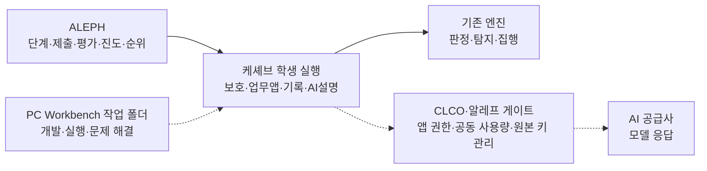

# 케셰브 제품 개요

케셰브는 4~6차 방어전에서 만드는 ZTNA·XDR 보안 Agent의 기본 이름입니다. 기존 1~3차 프로젝트가 있으면 보존하면서 `on-client`를 추가합니다. 3차를 끝내지 못했어도 4차 시작 틀로 새 작업 폴더에서 출발할 수 있습니다. 시작한 프로젝트 하나로 13~22단계를 이어 가며, 단계마다 새 저장소나 데이터베이스를 만들지 않습니다.

ALEPH는 단계, 제출, 평가, 진도, 순위를 다룹니다. 학생은 PC의 Workbench 작업 폴더에서 개발·실행·문제 해결을 진행합니다. CLCO는 AI 연결과 권한·사용량을 처리하는 게이트 서버입니다. 앱은 보호 현황, 업무 앱, 보안 기록, AI 설명을 담당합니다. 학생 앱을 실행할 때마다 Workbench를 켜 두지 않습니다.

기존 엔진이 판정, 탐지, 집행을 합니다. AI는 사건 근거를 설명하고 조치를 제안합니다. 조치 화면은 별도의 사람 확인을 받은 뒤 원천 처리 결과를 조회합니다. 실제 이용 권한이 연결되지 않은 기본 실행에서는 조치를 지원하지 않습니다. AI가 실패해도 기존 판정과 기록은 따로 동작합니다. 미확인은 정상이 아닙니다.

CLCO·알레프 게이트는 앱 권한, 공동 사용량, AI 연결을 처리합니다. 공급사 원본 열쇠는 중앙 게이트웨이에서 관리합니다. 기존 Workbench 로그인·연결을 활용해 학생이 따로 입력할 내용을 최소화하는 경로를 먼저 검토합니다. 앱 주소와 앱 전용 열쇠를 수동으로 넣는 방식은 아직 확정된 학생 절차가 아닌 로컬 개발용 연결안입니다. 기존 Workbench 열쇠를 복사하거나 다시 발급하지 않습니다. 자동 연결과 실제 계정의 운영 권한 연결은 준비 중입니다.

실선은 지금 설명하는 역할 관계입니다. 점선은 개발 도구와의 구분, 그리고 준비 중인 실제 신원 공급·운영 앱 발급·게이트 연결입니다. 현재 기본 앱은 그 준비가 끝나기 전까지 기본 차단입니다.

## 학생 화면

메뉴는 보호 현황, 업무 앱, 보안 기록입니다. 제공된 표와 `student/extension.mjs`에 학생이 표시하는 내용은 구분합니다. Node.js 24.19.0을 쓰고 외부 npm 의존성은 0입니다. `npm start`의 `127.0.0.1:5189`는 기본 미연결이고, `npm run demo`는 예제입니다. 서버 설정은 `.env`에만 두고 `node --env-file=.env src/server.mjs`로 실행합니다. 기존 학생 파일은 덮어쓰거나 지우거나 초기화하지 않습니다. 제공된 코드만으로 완료되지 않습니다.

## 평가에서 지금 말하는 범위

권장 기한이 지나도 감점하거나 차단하지 않습니다. 자동 통과 여부와 처음 통과한 서버 접수 시각으로 달성률·순위를 계산합니다. AI 의견은 비동기로 제공하며 점수·순위·통과·다음 단계 진행에 영향을 주지 않습니다. 늦게 오거나 생성에 실패해도 자동 통과 진도는 유지합니다. 순위 집계의 정확한 시각과 MCP 가산·운영 반영은 별도입니다.

## 보호 현황에서 보는 조회

공개 패키지 조회는 담당자가 승인한 npm 이름만 대상으로 합니다. 기본 목록이 비어 있으면 외부 조회는 0입니다. 정확한 이름·버전, 출처, 조회 시각, lock 해시를 남기고, 알려진 취약점·없음·확인 불가·일부·미조회를 구분합니다. 다음 페이지가 실패해도 기존 발견은 유지합니다. 조회 결과가 없다는 것은 그 시점의 알려진 항목이 없다는 뜻입니다. 256패키지 보호 상한을 넘으면 표시할 수 없고, 개수를 세었다고 가산되지 않습니다.

## 오류가 나면

`GET /api/diagnostics`로 도움 정보를 불러오고, 사용자가 확인한 뒤 복사합니다. 담당자에게는 본인 확인된 요청 시각, 오류 code, 버전만 전달합니다. 자동 전송은 0입니다.

| code | 의미 |
| --- | --- |
| `ON_AI_PROVISIONING_PENDING` | 담당자 앱 권한 준비 |
| `WB_CLCO_AUTH_REQUIRED` | 앱 전용 열쇠 확인 |
| `WB_CLCO_ACCESS_BLOCKED` | 이용 권한 확인 |
| `WB_CLCO_SESSION_CLOSED` | 현재 이용 시간 확인 |
| `WB_CLCO_COHORT_BUDGET_EXHAUSTED` | 반 사용량을 담당자에게 확인 |
| `WB_CLCO_RATE_LIMITED` | 잠시 뒤 직접 다시 요청 |
| `WB_CLCO_TIMEOUT`, `WB_CLCO_NETWORK_ERROR` | 주소와 연결을 확인한 뒤 직접 재시도 |
| `MODEL_NOT_CONFIGURED` | 담당자가 승인한 모델 |

열쇠를 바꾸면 앱 전용 자격만 처리합니다. Workbench 열쇠 재발급을 요구하지 않습니다. 주소와 열쇠가 있어도, 담당자가 학생·프로젝트·기간·권한을 확인해 연결을 준비하기 전에는 승인되지 않습니다. 모델은 담당자가 승인한 ID만 쓰며, 임의 기본값이나 목록 첫 항목을 고르지 않습니다.

코드별 자세한 원인과 할 일은 [CONNECTION_TROUBLESHOOT.md](CONNECTION_TROUBLESHOOT.md)를 봅니다.

## 지금 경계

17·18 화면과 앱 게이트는 로컬 PC·HTTP·사용량 원장·모의 AI로 확인했습니다. 실제 학생 계정·운영 발급·유료 AI는 아직 확인하지 않았습니다. 모델 연결 점검은 모델 목록에 접근할 수 있는지 확인합니다. 실제 사건 설명의 근거와 반환은 별도로 확인합니다. 이 개요는 제공 안내이며 학생 성취나 운영 도입을 뜻하지 않습니다.
